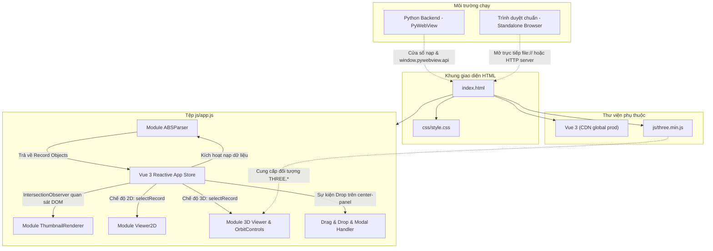

# Kiến Trúc Liên Kết & Luồng Dữ Liệu (connection.md)

Tài liệu này giải thích chi tiết cấu trúc liên kết giữa các thành phần, luồng xử lý dữ liệu từ đầu vào đến đầu ra, giao thức giao tiếp API và cách thức tương tác giữa các hệ thống đồ họa trong dự án **ABS Viewer**.

---

## 1. Sơ đồ liên kết tổng thể các tệp



---

## 2. Giao tiếp Backend & Cầu nối API (PyWebView Bridge)

Ứng dụng được thiết kế theo mô hình **Graceful Degradation** (Tự điều chỉnh mượt mà theo môi trường thực thi):

### 2.1. Kiểm tra môi trường qua hàm `getApi()`
```javascript
function getApi() {
    if (window.pywebview && window.pywebview.api) {
        return window.pywebview.api;
    }
    return null;
}
```

### 2.2. Chi tiết các phương thức API PyWebView (`window.pywebview.api`)
Khi chạy trong Desktop Shell được bọc bởi Python PyWebView, ứng dụng gọi các hàm asynchronous được expose từ Python backend:

1. **`api.open_abs_files()`**
   - **Mục đích:** Mở hộp thoại chọn tệp hệ thống trên máy tính (hỗ trợ chọn nhiều tệp cùng lúc).
   - **Dữ liệu trả về từ Python:** Mảng danh sách các object tệp:
     ```json
     [
       {
         "name": "Beam_Level_2.abs",
         "path": "C:\\Projects\\Structure\\Beam_Level_2.abs",
         "folder": "C:\\Projects\\Structure",
         "size": 10452,
         "text": "BF2D@..."
       }
     ]
     ```
   - **Xử lý bên JS:** Giao mảng kết quả cho phương thức xử lý tệp tập trung `processIncomingFiles(result)` của Vue (kiểm tra trùng tên và xử lý thay thế/bổ sung).

2. **`api.reload_file(path)`**
   - **Tham số:** `path` (chuỗi đường dẫn tệp tuyệt đối trên ổ cứng).
   - **Mục đích:** Đọc lại nội dung tệp trực tiếp từ đĩa mà không cần mở lại hộp thoại, dùng khi người dùng chỉnh sửa tệp `.abs` từ phần mềm CAD/BIM bên ngoài và bấm nút **🔄 Reload**.
   - **Dữ liệu trả về:** Object thông tin tệp mới nhất kèm trường `text`.

3. **`api.get_settings()`**
   - **Mục đích:** Đọc cấu hình người dùng đã lưu trước đó (ví dụ tên dự án `projectName`).
   - **Thời điểm gọi:** Tự động gọi trong hook `mounted()` của Vue.

4. **`api.save_settings(settingsObject)`**
   - **Mục đích:** Lưu lại thiết lập người dùng xuống đĩa (ví dụ `{ projectName: '...' }`).
   - **Thời điểm gọi:** Sau khi nạp tệp thành công trong `addFiles()` và `replaceAndAddFiles()`.

### 2.3. Cơ chế Dự phòng Trình duyệt (Browser Fallback)
Nếu `getApi()` trả về `null` (khi mở `index.html` trực tiếp bằng trình duyệt Google Chrome, Edge, Firefox):
- Hàm `openViaBrowser()` sẽ tự động tạo một thẻ input ẩn:
  `<input type="file" id="hidden-file-input" multiple accept=".abs" style="display:none">`.
- Lắng nghe sự kiện `change`, sử dụng đối tượng chuẩn `FileReader` (`readAsText()`) để đọc chuỗi văn bản của từng tệp.
- Chuyển đổi dữ liệu sang cùng cấu trúc object như PyWebView trả về và chuyển vào `processIncomingFiles(results)`.
- **Kết quả:** Mọi tính năng phân tích cú pháp, render 2D/3D hoạt động 100% độc lập không cần backend!

### 2.4. Cơ chế Kéo Thả Tệp (Drag & Drop) & Xử lý Trùng Tên
Người dùng có thể kéo thả trực tiếp một hoặc nhiều tệp `.abs` từ File Explorer vào vùng `.center-panel`:
1. **Lắng nghe sự kiện kéo thả:**
   - `@dragenter.prevent="onDragEnter"` / `@dragleave="onDragLeave"`: Sử dụng biến đếm `dragCounter` để quản lý trạng thái `isDraggingOver` và hiển thị lớp phủ `.drop-overlay` mượt mà, không bị hiện tượng nhấp nháy (flicker) khi lướt qua các thẻ con.
   - `@dragover.prevent="onDragOver"`: Thiết lập `dropEffect = 'copy'`.
   - `@drop.prevent="onDrop"`: Thu thập danh sách `e.dataTransfer.files`.
2. **Quy trình xử lý tệp kéo vào (`handleDroppedFiles`):**
   - Lọc các tệp có đuôi `.abs` và đọc nội dung song song bằng `FileReader`.
   - **Tình huống 1: Chưa có tệp nào đang mở:** Nạp toàn bộ các tệp kéo vào qua `addFiles()`.
   - **Tình huống 2: Đã có sẵn tệp:**
     - Kiểm tra tên tệp so với danh sách `this.files`.
     - *Nếu không có tệp trùng tên:* Mở bổ sung toàn bộ vào danh sách hiện có.
     - *Nếu phát hiện tệp trùng tên:* Kích hoạt Modal Popup (`duplicateConfirmModal.show = true`) liệt kê danh sách các tệp bị trùng.
3. **Phản hồi từ Modal Popup:**
   - **Chọn YES (`confirmDuplicateDrop`):** Kích hoạt `replaceAndAddFiles()`: cập nhật thay thế nội dung của các tệp trùng tên, giữ nguyên vị trí của chúng, bổ sung các tệp mới không trùng vào cuối danh sách, xóa cache thumbnails và làm mới toàn bộ bảng băm `recordIndex` cũng như render lại view.
   - **Chọn NO (`cancelDuplicateDrop`):** Hủy bỏ toàn bộ thao tác nạp tệp, giữ nguyên vẹn dữ liệu dự án hiện tại.

### 2.5. Modal Thông Tin (Giấy phép & Phiên bản)
Nút ℹ️ trên `.toolbar-right` mở hộp thoại Modal Popup (`showLicenseModal`) hiển thị:
- Tab **Giấy phép**: nội dung `THIRD-PARTY-NOTICES.md` (giấy phép Three.js MIT, Vue 3 MIT, PyWebView BSD-3-Clause) kèm thông tin tác giả "Sản phẩm cá nhân của thuc.hoang — MACZT VietNam".
- Tab **Phiên bản**: nội dung `version.md` (lịch sử phiên bản và Coming Soon).

Nội dung được nhúng trong `<script type="text/plain" id="license-text">` và `<script type="text/plain" id="version-text">` trong `index.html`, nạp vào Vue state (`licenseText`, `versionText`) trong `mounted()`, và render thành HTML qua hàm `renderMarkdown()` (hỗ trợ heading, list, bold, inline code, code fence, horizontal rule) bằng `v-html` trong `.md-preview`.

---

---

## 3. Luồng dữ liệu chi tiết (End-to-End Data Flow)

### Bước 1: Tiếp nhận tệp & Tích lũy chuỗi
1. Người dùng bấm **📂 Open ABS** hoặc kéo thả tệp vào vùng `.center-panel`.
2. Nhận danh sách tệp chứa chuỗi text thô.
3. Kích hoạt `ABSParser.parse(rawText, fileName, fileIndex)`.
4. Trình phân tích giải quyết vấn đề tự xuống dòng (line-wrap) của các trình soạn thảo: cộng dồn chuỗi vào biến `pending` cho đến khi gặp dấu kết thúc checksum `C<digits>@` rồi mới phân tách theo tiền tố chuẩn `BF(2D|3D|WE|MA|GT|AU)@`.

### Bước 2: Phân rã khối BVBS & Kiến tạo hình học
1. Mỗi câu lệnh BVBS được phân tách thành các Block:
   - `H`: Header (Đường kính `d`, chiều dài tổng `l`, số lượng `n`, trọng lượng đơn `e`, mác thép `g`, loại lưới `m`, kích thước lưới `b`/`h`...).
   - `G`, `Gx`, `Gy`: Khối hình học uốn.
   - `M`: Khối múp nối coupler (nhà sản xuất `a`/`n`, mã hiệu `b`/`o`).
   - `C`: Khối checksum xác thực tính toàn vẹn.
2. Xây dựng toạ độ:
   - **`BF2D`**: Tính toán toạ độ `[x, y, 0]` tuần tự qua góc hướng di chuyển (`heading`) và hàm lượng giác `Math.cos/sin`, hỗ trợ nối cung tròn `appendArc()`.
   - **`BF3D`**: Đọc các bộ vector gia số `x/y/z` (offset tương đối dX, dY, dZ từ điểm trước đó) để tạo mảng điểm 3D.
   - **`BFWE`**: Tạo đường xoắn ốc 3D (Helix) dựa trên đa giác 2D kết hợp số vòng `n` và bước xoắn `g`.
   - **`BFMA` / `BFGT` / `BFAU`**: Dựng đa giác lưới phẳng hoặc đường uốn lưới.
3. Tạo hình hiển thị chống đè (`createDisplayGeometry`):
   - Nếu phát hiện móc đai (stirrup) có đoạn kết thúc đè khít lên đoạn đầu (trùng phương, cùng đoạn thẳng), hệ thống tự dịch chuyển lệch đoạn móc ra ngoài một khoảng `DISPLAY_STIRRUP_OVERLAP_OFFSET = 30 mm` trong đối tượng `record.preview`.
   - **Nguyên tắc vàng:** `record.geometry` giữ toạ độ kỹ thuật gốc chuẩn; `record.preview` dùng cho việc hiển thị đồ họa.

### Bước 3: Đưa dữ liệu vào Vue State & Tối ưu hóa tính toán (Caching)
- Dữ liệu được đưa vào mảng `files` và `allRecords`.
- **Tối ưu hóa tổng hợp (Pre-aggregation):**
  Tổng khối lượng thép thanh (`fileRebarWeight`), khối lượng lưới (`fileMeshWeight`), số lượng thanh, số lượng coupler được tính toán và gán ngay vào `file` object tại thời điểm parse:
  ```javascript
  file.rebarWeight = rebarWeight;
  file.meshWeight = meshWeight;
  file.bars = totalBars;
  ```
  *Lợi ích:* Giúp template hiển thị tức thì mà không cần chạy vòng lặp lặp đi lặp lại qua hàng ngàn records trong mỗi chu kỳ render của Vue.
- `buildRecordIndex()`: Tạo bảng băm ánh xạ `recordIndex[id] -> record` với độ phức tạp $O(1)$ cho việc tra cứu thumbnail.

### Bước 4: Hiển thị danh sách & Kết xuất Thumbnail trễ (Lazy Loading)
1. Bảng Vue hiển thị các dòng `<tr>`, mỗi dòng có một `<canvas class="thumb" :id="'thumb_' + item.id">`.
2. Hàm `setupThumbnailObserver()` khởi tạo `IntersectionObserver` với vùng đệm `rootMargin: '60px'`.
3. Chỉ khi thẻ canvas nào thực sự cuộn vào vùng nhìn thấy của `.center-panel`, observer mới kích hoạt hàm `ThumbnailRenderer.render(canvas, record)`.
4. Sau khi vẽ xong, `record.id` được lưu vào `ThumbnailRenderer.cache` (`Map`). Các lần cuộn sau sẽ bỏ qua hoàn toàn, tối ưu hiệu năng tối đa.

### Bước 5: Lựa chọn vị trí & Hiển thị chi tiết (2D hoặc 3D)
Khi người dùng bấm chọn một dòng trên bảng (`selectRecord(item)`):
- Cập nhật biến trạng thái `selectedRecord = item`.
- Panel thuộc tính bên phải lập tức hiển thị thông số chi tiết.
- Gọi hàm `updateViewer()`:
  - **Nếu `viewerMode === '2d'`:** Chuyển record sang `Viewer2D.setRecord(item)`.
  - **Nếu `viewerMode === '3d'`:** Kích hoạt `render3D(item)`.

---

## 4. Chi tiết cơ chế đồ họa 2D & 3D

### 4.1. Khung nhìn 2D (`Viewer2D`)
- **Tọa độ & Phép biến đổi:** Quản lý bởi đối tượng `transform = { scale, ox, oy }`.
  - Từ không gian thực (mm) sang màn hình (pixel):
    $$x_{screen} = x_{world} \times scale + ox$$
    $$y_{screen} = y_{world} \times scale + oy$$
  - Từ màn hình sang không gian thực:
    $$x_{world} = \frac{x_{screen} - ox}{scale}$$
- **Kích thước thông minh (Smart Dimensions):**
  - Tự động tính tâm đa giác (Centroid).
  - Véc-tơ pháp tuyến đo kích thước được định hướng luôn quay ra phía ngoài (xa tâm), giúp đường gióng kích thước của các đai thép khép kín không bao giờ bị cắt chéo vào ruột hình.
- **Đánh dấu điểm uốn & Coupler:**
  - Điểm xuất phát (P0): Chấm tròn đỏ nổi bật.
  - Các mắt uốn: Điểm xanh lam.
  - Coupler: Khối hộp màu vàng cam `#c26c06` kèm nhãn tên loại coupler.
  - Góc bẻ: Chỉ vẽ nhãn góc với các góc uốn khác $90^\circ$ để tránh rối mắt bản vẽ.

### 4.2. Khung nhìn 3D (`Viewer3D` với Three.js)
- **Ánh xạ hệ trục:**
  Tọa độ thép từ bản vẽ BVBS thường nằm trên mặt phẳng $XY$. Khi chuyển sang không gian Three.js 3D, hệ thống hoán vị:
  $$[x, y, z]_{BVBS} \longrightarrow (x, z, y)_{Three.js}$$
  Điều này giúp hình dạng thép nằm tự nhiên trên mặt lưới ngang sàn $XZ$.
- **Dựng hình chính xác (Cylinder per Segment):**
  - Không sử dụng đường ống cong spline nội suy mềm (spline làm biến dạng góc uốn chuẩn).
  - Với mỗi cặp điểm nối tiếp $P_i \rightarrow P_{i+1}$, sinh một `THREE.CylinderGeometry` riêng biệt, căn chỉnh phương vị thông qua quaternion `setFromUnitVectors([0, 1, 0], direction)`.
  - Đặt các quả cầu `THREE.SphereGeometry` tại các khớp nối điểm uốn để triệt tiêu mọi khe nứt góc giữa hai hình trụ.
- **HTML DOM Overlay cho nhãn kích thước 3D (`#segment-labels`):**
  - Thay vì vẽ chữ 3D (TextGeometry) tốn bộ nhớ hoặc dùng Three.js Canvas Texture làm giảm độ sắc nét:
  - Tạo các thẻ `<div class="segment-label">` nổi trực tiếp trên canvas WebGL.
  - Trong vòng lặp hoạt họa `animate3D()` (`requestAnimationFrame`), mỗi khung hình tính tọa độ trung điểm đoạn thẳng 3D, dùng hàm `vector.project(camera3D)` để lấy tọa độ màn hình 2D tương ứng và gán vào `style.left`, `style.top`.
  - Tự động ẩn (`opacity = 0`) nếu điểm nằm phía sau camera ($NDC.z \notin [-1, 1]$) hoặc vượt ngoài viền khung nhìn.
